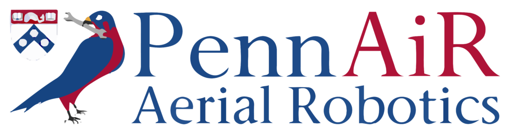

:layout: landing

PennAiR Monorepo
==================

.. rst-class:: lead

    Welcome to the Monorepo for the Penn Aerial Robotics Software Team! This repository is designed
    to centralize all code and documentation for our projects.

    Click **Get Started** or any of the Quick Links below.

.. container:: buttons

    :doc:`Get Started <getting-started/index>`
    `GitHub <https://github.com/pennaerial/monorepo>`_

Quick Links
-----------

.. grid:: 1 1 2 2
    :gutter: 2
    :padding: 0

    .. grid-item-card:: :iconify:`lucide:compass` Getting Started
        :link: getting-started/index
        :link-type: doc

        Understand the monorepo, set up software and hardware, and make your first contribution.

    .. grid-item-card:: :iconify:`lucide:map` Documentation Map
        :link: getting-started/organization
        :link-type: doc

        Find each learning path and understand the yellow in-progress page markers.

    .. grid-item-card:: :iconify:`lucide:cpu` Payload Controller ESP
        :link: pc/index
        :link-type: doc

        Build and simulate the C++ controller, then learn drivers, DDS, estimation, and motor control.

    .. grid-item-card:: :iconify:`lucide:network` ROS
        :link: ros/index
        :link-type: doc

        Build and inspect ROS nodes, then learn the shared framework and IARC/SAE structure.

    .. grid-item-card:: :iconify:`lucide:git-pull-request` CI/CD and Docker
        :link: ci/index
        :link-type: doc

        Understand automatic checks, reproduce failures, and follow image and docs delivery.

.. toctree::
   :hidden:
   :maxdepth: 4

   Getting Started <getting-started/index>
   Payload Controller ESP <pc/index>
   ROS <ros/index>
   CI/CD and Docker <ci/index>

Active Contributors
-------------------

.. pennair-contributors::
    :path: contributors
    :repo: pennaerial/monorepo
    :role: active

Past Contributors (Alums)
-------------------------

.. pennair-contributors::
    :path: contributors
    :repo: pennaerial/monorepo
    :role: alum

.. monkeytype-leaderboard::
    :path: contributors
